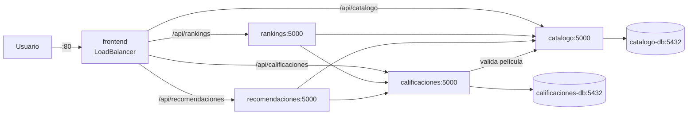

# Manifiestos para EKS / Minikube (Persona 2)

Archivos: `calificaciones.yaml` (+ Postgres, Secret, Job de seed), `rankings.yaml` (+ HPA), `recomendaciones.yaml`, `frontend.yaml`.
`catalogo*.yaml` los mantiene Josué. El Service de catálogo debe llamarse `catalogo` y usar el puerto 5000.

## Comunicación entre servicios



## Variables (las sustituye `envsubst`)

| Variable | Ejemplo |
|---|---|
| `ECR_REGISTRY` | `123456789012.dkr.ecr.us-east-1.amazonaws.com` |
| `IMAGE_TAG` | SHA del commit |
| `CALIFICACIONES_DB_PASSWORD` | no se sube a Git |

## Validar sin clúster (dry-run)

```bash
export ECR_REGISTRY=local IMAGE_TAG=dev CALIFICACIONES_DB_PASSWORD=solo-local
for f in calificaciones rankings recomendaciones frontend; do
  envsubst '${ECR_REGISTRY} ${IMAGE_TAG} ${CALIFICACIONES_DB_PASSWORD}' < k8s/eks/$f.yaml \
    | kubectl apply --dry-run=client -f -
done
```

## Probar en Minikube

```bash
minikube start && minikube addons enable metrics-server
kubectl create namespace mini-netflix   # usar el mismo nombre que defina la Fase 5
for s in calificaciones rankings recomendaciones frontend; do
  docker build -t local/mini-netflix/$s:dev ./$s && minikube image load local/mini-netflix/$s:dev
done
kubectl -n mini-netflix delete job calificaciones-seed --ignore-not-found
for f in calificaciones rankings recomendaciones frontend; do
  envsubst '${ECR_REGISTRY} ${IMAGE_TAG} ${CALIFICACIONES_DB_PASSWORD}' < k8s/eks/$f.yaml \
    | kubectl apply -n mini-netflix -f -
done
kubectl -n mini-netflix get pods,svc,hpa
minikube service frontend -n mini-netflix --url
```
(En Minikube, con `ECR_REGISTRY=local` las imágenes se resuelven como `local/mini-netflix/<servicio>:dev`.)
